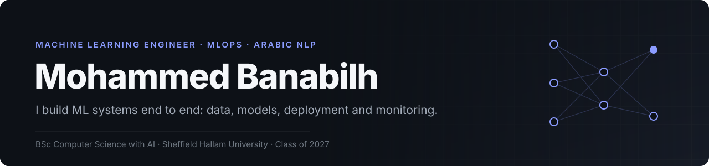
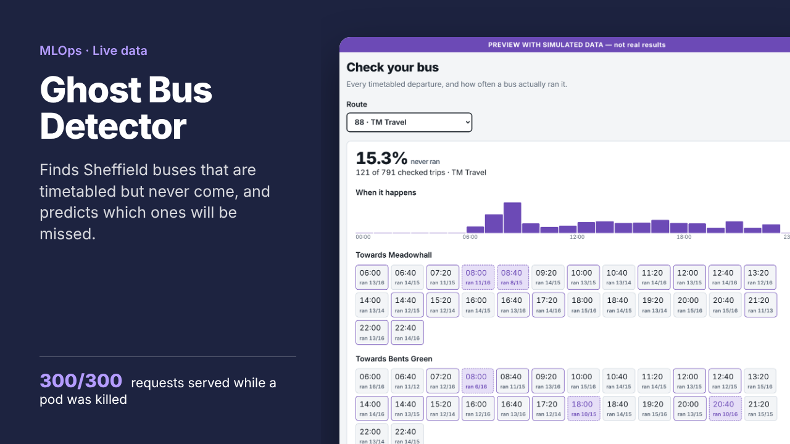
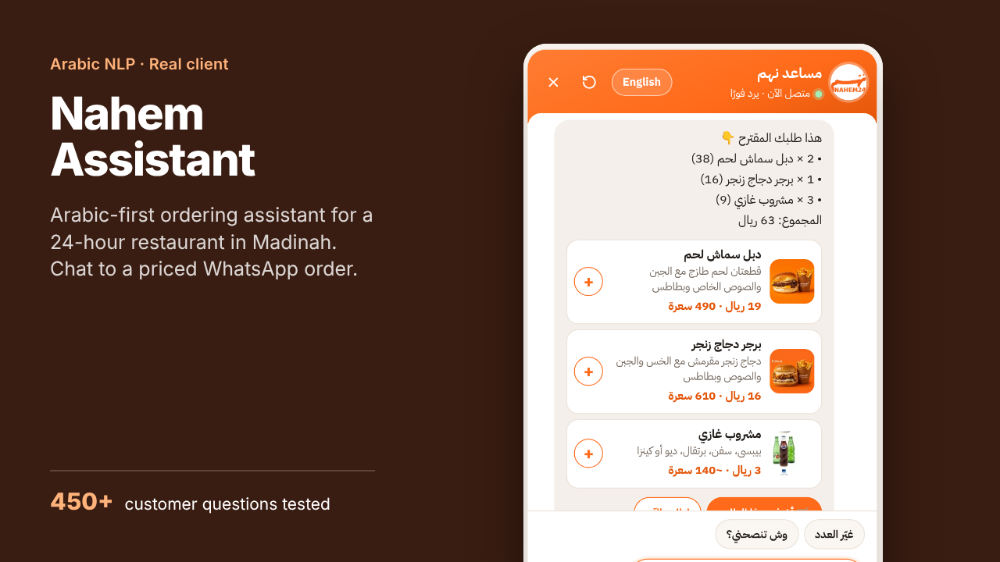
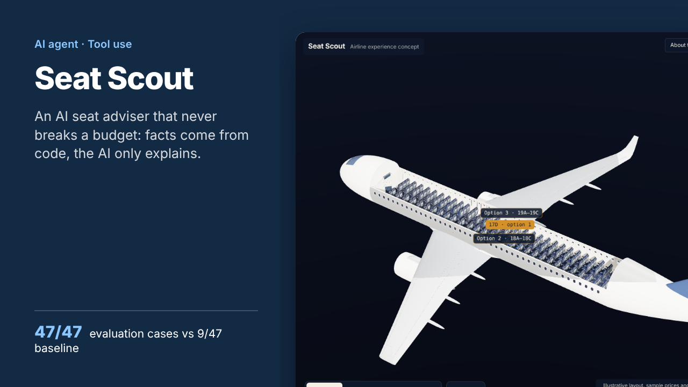
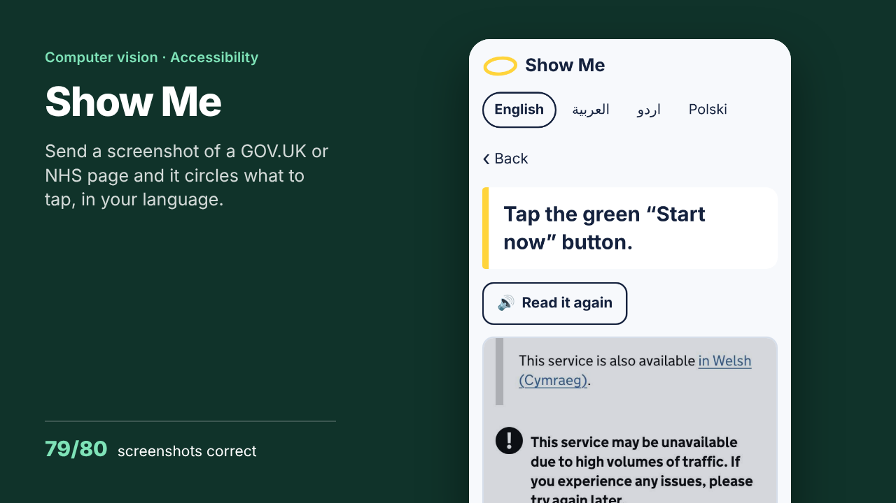
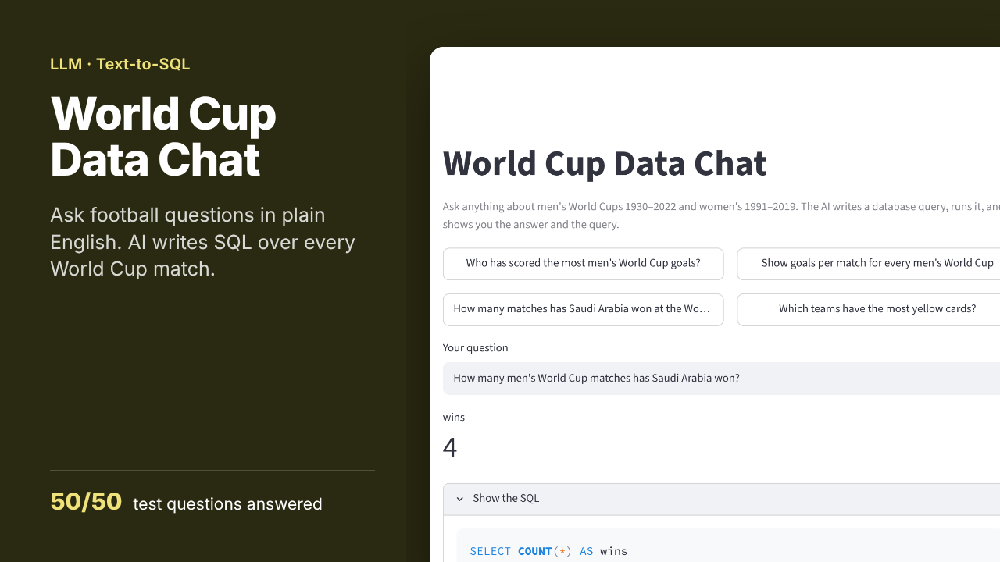
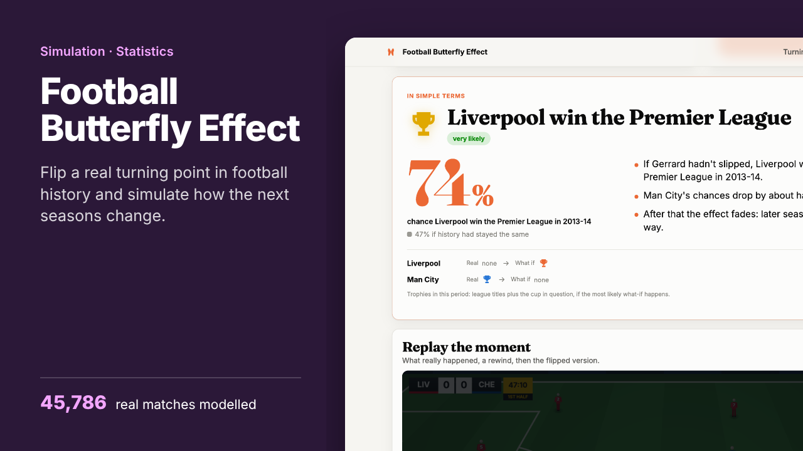

  
  
  

Final-year Computer Science with AI student at Sheffield Hallam University. I work on the full machine learning lifecycle: collecting and cleaning data, training and evaluating models against honest baselines, and shipping them as tested services with monitoring and automatic retraining. I also build AI tools that work natively in **Arabic and English**.

**Currently:** open to ML engineering and MLOps internships, and graduate roles from July 2027.

## Featured work

<table>
<tr>
<td width="50%" valign="top">

<b>Ghost Bus Detector</b> &nbsp;·&nbsp; <a href="https://mohammed-890.github.io/ghost-bus/">Live</a> · <a href="https://github.com/Mohammed-890/ghost-bus">Code</a> 
MLOps pipeline on live government bus GPS data. Champion/challenger model promotion with MLflow, drift-triggered retraining, FastAPI on Kubernetes.
</td>
<td width="50%" valign="top">

<b>Nahem Assistant</b> &nbsp;·&nbsp; <a href="https://mohammed-890.github.io/nahem-chatbot/">Demo</a> · <a href="https://github.com/Mohammed-890/nahem-chatbot">Code</a> 
Arabic-first ordering assistant built for a real restaurant client. Turns a conversation into a priced WhatsApp order.
</td>
</tr>
<tr>
<td width="50%" valign="top">

<b>Seat Scout</b> &nbsp;·&nbsp; <a href="https://github.com/Mohammed-890/seat-scout">Code</a> 
Tool-using AI agent for seat selection. Facts come from code, the model only explains, so it can't invent prices.
</td>
<td width="50%" valign="top">

<b>Show Me</b> &nbsp;·&nbsp; <a href="https://mohammed-890.github.io/show-me/">Demo</a> · <a href="https://github.com/Mohammed-890/show-me">Code</a> 
Computer vision accessibility tool: reads a screenshot of a government web page and shows what to tap, in your language.
</td>
</tr>
<tr>
<td width="50%" valign="top">

<b>World Cup Data Chat</b> &nbsp;·&nbsp; <a href="https://github.com/Mohammed-890/worldcup-data-chat">Code</a> 
Natural language to SQL over every World Cup match, with the generated query shown for every answer.
</td>
<td width="50%" valign="top">

<b>Football Butterfly Effect</b> &nbsp;·&nbsp; <a href="https://github.com/Mohammed-890/football-butterfly-effect/blob/main/docs/demo.mp4">Demo</a> · <a href="https://github.com/Mohammed-890/football-butterfly-effect">Code</a> 
Statistical simulation over 45,786 real matches: change one moment in football history and model what follows.
</td>
</tr>
</table>

### Also

| Project | Summary |
|---|---|
| [ChurnOps](https://github.com/Mohammed-890/churn-mlops) | Churn model served through a tested FastAPI service, containerised with Docker, infrastructure in Terraform for AWS ECS. ROC-AUC 0.84 on 1,409 held-out customers. |
| [Sheffield Road Collision ML](https://github.com/Mohammed-890/sheffield-collision-ml) | Classification, regression and clustering on UK road-collision data. University project, graded a First. |
| AttendFlow *(private)* | Attendance system built from three FastAPI services, PostgreSQL, Redis Streams and a React front end. |
| Onyx reporting dashboard *(private)* | Bilingual multi-client reporting layer over a live ERP system for retail clients. |

## Tech stack

**ML & data** &nbsp; Python · scikit-learn · pandas · MLflow · SQL 
**Serving & infrastructure** &nbsp; FastAPI · Docker · Kubernetes · Helm · Terraform · Argo CD · AWS 
**Monitoring & delivery** &nbsp; Prometheus · GitHub Actions 
**Application** &nbsp; TypeScript · JavaScript · Java · React

## How I work

- **Every model has a baseline.** If it can't beat a simple rule, it doesn't ship.
- **Results are reported on unseen data**, and every project documents its limitations.
- **Untested means unfinished.** Evaluation sets, regression tests and end-to-end tests are part of the build, not an afterthought.
