<a href="https://mohammed-890.github.io/"></a>

  
  
  

Final-year **Computer Science with AI** student at Sheffield Hallam University (graduating 2027). I build machine learning systems end to end, from collecting the data to running the model in production with monitoring and automatic retraining, and I build AI tools that work in **Arabic and English**.

## Select a game

Every cartridge is a real project. Click one to play the demo or read the code.

<table>
<tr>
<td width="50%"><a href="https://mohammed-890.github.io/nahem-chatbot/"></a></td>
<td width="50%"><a href="https://mohammed-890.github.io/show-me/"></a></td>
</tr>
<tr>
<td width="50%"><a href="https://github.com/Mohammed-890/seat-scout"></a></td>
<td width="50%"><a href="https://github.com/Mohammed-890/football-butterfly-effect/blob/main/docs/demo.mp4"></a></td>
</tr>
<tr>
<td width="50%"><a href="https://github.com/Mohammed-890/worldcup-data-chat"></a></td>
<td width="50%"><a href="https://mohammed-890.github.io/ghost-bus/"></a></td>
</tr>
</table>

<a href="https://mohammed-890.github.io/ghost-bus/"></a>

<!-- game:start -->
## Bonus stage: did this bus turn up?

Every day this asks about a **real departure** from Sheffield, checked by [Ghost Bus Detector](https://github.com/Mohammed-890/ghost-bus) against live GPS.

> **Route 115** (First South Yorkshire), **13:46** on **Tuesday 10 November**
> from Rotherham Interchange/B1 to Laudsdale Road/Lady Oak Road

Did a bus actually run it?

 &nbsp; 

0 guesses today · 0 guesses in total

Yesterday's bus (route 95 at 11:25): **it never came**. 0 of 0 guessed right.
<!-- game:end -->


<b>Player manual: how Ghost Bus works</b>

 

Every bus in England reports its GPS position to the government's Bus Open Data Service. Ghost Bus compares that with the timetable, trip by trip, to find the buses that never came, then predicts which departures are likely to be missed. A trip only counts as a ghost when the live feed and the operator were reporting reliably.

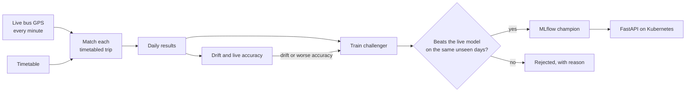

- **Training and serving share one feature pipeline**, so they can't drift apart.
- **A new model only goes live if it beats the current one** on the same days neither has seen.
- **Retrains itself** on data drift (PSI) or when live accuracy drops.
- **Every push is tested on a real Kubernetes cluster**, including killing a pod while 300 requests come in. None failed.

<b>Secret levels: more projects</b>

 

| Project | What it is |
|---|---|
| [ChurnOps](https://github.com/Mohammed-890/churn-mlops) | Customer churn model behind a tested FastAPI service, Docker and Terraform for AWS ECS. ROC-AUC 0.84 on 1,409 held-out customers. |
| [Sheffield Road Collision ML](https://github.com/Mohammed-890/sheffield-collision-ml) | End-to-end ML on UK road-collision data: classification, regression and clustering. University project, graded a First. |
| AttendFlow | University attendance system: three FastAPI services, PostgreSQL, Redis Streams and a React front end. Software Architecture coursework (private). |
| Onyx AI dashboard | Bilingual multi-client reporting over a live ERP system, built for a retail client (private). |

<b>House rules: how I work</b>

 

- **Every model gets a baseline.** If it can't beat a simple rule, it isn't ready.
- **Results are measured on data the model hasn't seen**, and each project says what it can't do.
- **If it isn't tested, it isn't done.** Evaluation sets, regression tests and end-to-end tests on every project.

<a href="https://www.linkedin.com/in/mohammed-banabilh-6340553b0/"></a>

Pixel font: Press Start 2P (SIL Open Font License).
