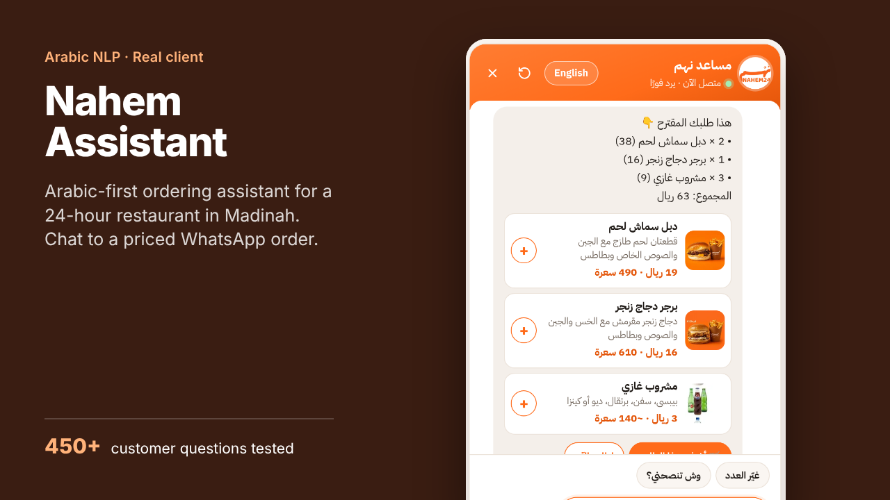
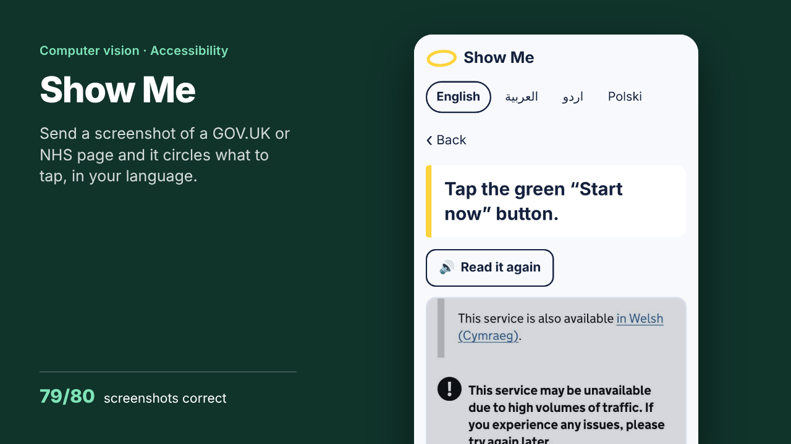
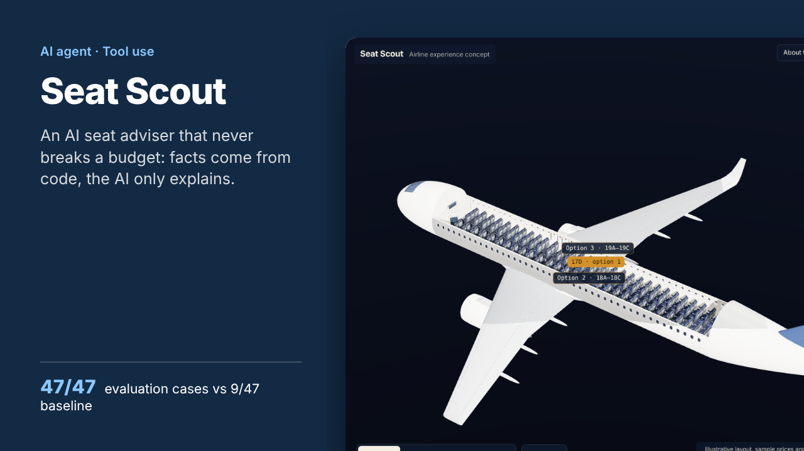
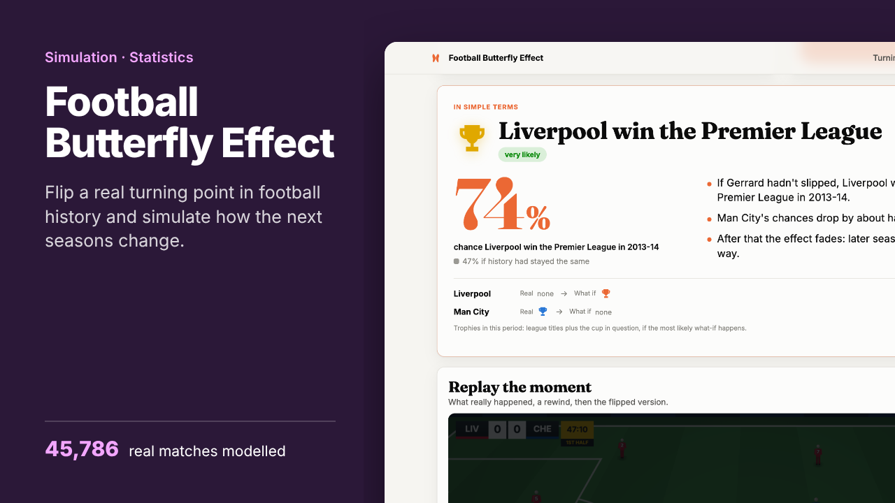
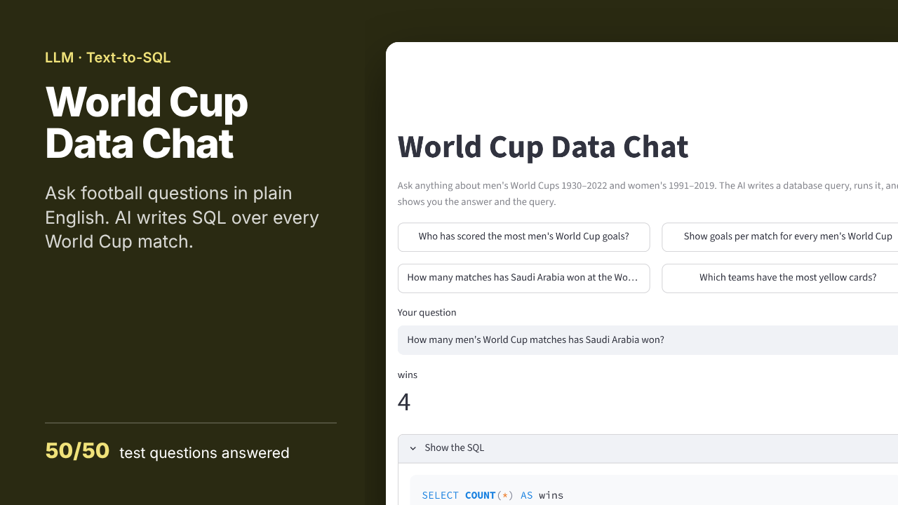
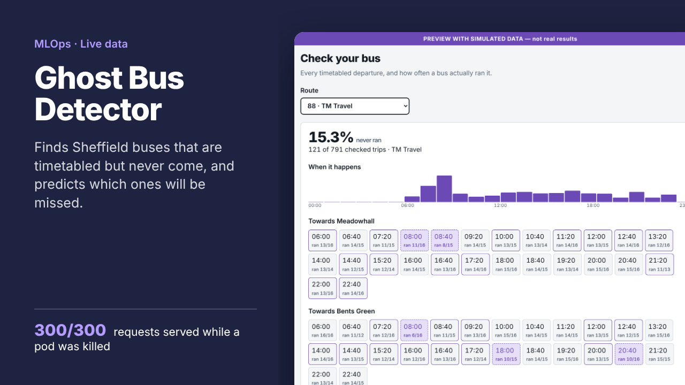
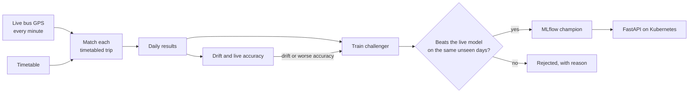

  

  
  
  

Final-year **Computer Science with AI** student at Sheffield Hallam University, graduating in 2027. I build machine learning systems end to end: collecting the data, training and testing the model honestly, and running it in production with monitoring and automatic retraining. I speak **Arabic and English** and build AI tools for both.

**Open to** ML engineering and MLOps internships now, and graduate roles from July 2027.

> **Try them live:** [mohammed-890.github.io](https://mohammed-890.github.io) has an interactive map of everything here, and you can use the Nahem chatbot and Show Me right on the page.

## Featured projects

Click a card to try it or read the code.

<table>
<tr>
<td width="50%" valign="top">

 <b><a href="https://mohammed-890.github.io/nahem-chatbot/">Live demo with guided tour</a></b> · <a href="https://github.com/Mohammed-890/nahem-chatbot">Code</a>
 JavaScript · Arabic NLP · Google Apps Script · Gemini
</td>
<td width="50%" valign="top">

 <b><a href="https://mohammed-890.github.io/show-me/">Live demo</a></b> · <a href="https://github.com/Mohammed-890/show-me">Code</a>
 JavaScript · OCR (Tesseract) · runs fully in the browser
</td>
</tr>
<tr>
<td width="50%" valign="top">

 <b><a href="https://github.com/Mohammed-890/seat-scout">Code and screenshots</a></b>
 TypeScript · Node.js · Claude API tool use · Three.js · Playwright
</td>
<td width="50%" valign="top">

 <b><a href="https://github.com/Mohammed-890/football-butterfly-effect/blob/main/docs/demo.mp4">51-second demo video</a></b> · <a href="https://github.com/Mohammed-890/football-butterfly-effect">Code</a>
 Python · NumPy · Elo + Poisson model · Monte Carlo · FastAPI
</td>
</tr>
<tr>
<td width="50%" valign="top">

 <b><a href="https://github.com/Mohammed-890/worldcup-data-chat">Code</a></b>
 Python · SQLite · LLM text-to-SQL · Streamlit
</td>
<td width="50%" valign="top">

 <b><a href="https://mohammed-890.github.io/ghost-bus/">Live site</a></b> · <a href="https://github.com/Mohammed-890/ghost-bus">Code</a>
 Python · scikit-learn · MLflow · FastAPI · Kubernetes · Terraform · Argo CD
</td>
</tr>
</table>

<b>How Ghost Bus works</b>, with live numbers (click to open)

 

<!-- ghostbus:start -->
| Ghost Bus, live from Sheffield | |
|---|---|
| Trips judged | **666** |
| Ghost buses found | **1 (0.1%)** |
| Last 7 days | **1 of 666 trips never came** |
| Days collected | **1 (since 1 Nov 2026)** |

Updated automatically every day from the project's live data · last update 2 Nov 2026
<!-- ghostbus:end -->

Every bus in England reports its GPS position to the government's Bus Open Data Service. Ghost Bus compares that with the timetable, trip by trip, to find the buses that never came, then predicts which departures are likely to be missed. A trip only counts as a ghost when the live feed and the operator were reporting reliably.

- **Training and serving share one feature pipeline**, so they can't drift apart.
- **A new model only goes live if it beats the current one** on the same days neither has seen.
- **Retrains itself** on data drift (PSI) or when live accuracy drops.
- **Every push is tested on a real Kubernetes cluster**, including killing a pod while 300 requests come in. None failed.

<b>More projects</b>

 

| Project | What it is |
|---|---|
| [ChurnOps](https://github.com/Mohammed-890/churn-mlops) | Customer churn model behind a tested FastAPI service, Docker and Terraform for AWS ECS. ROC-AUC 0.84 on 1,409 held-out customers. |
| [Sheffield Road Collision ML](https://github.com/Mohammed-890/sheffield-collision-ml) | End-to-end ML on UK road-collision data: classification, regression and clustering. University project, graded a First. |
| AttendFlow | University attendance system: three FastAPI services, PostgreSQL, Redis Streams and a React front end. Software Architecture coursework (private). |
| Onyx AI dashboard | Bilingual multi-client reporting over a live ERP system, built for a retail client (private). |

## Tools I use

  
  
  
  
  
  
  
  
  
  
  
  
  
  
  
  

## How I work

- **Every model gets a baseline.** If it can't beat a simple rule, it isn't ready.
- **Results are measured on data the model hasn't seen**, and each project says what it can't do.
- **If it isn't tested, it isn't done.** Evaluation sets, regression tests and end-to-end tests on every project.
